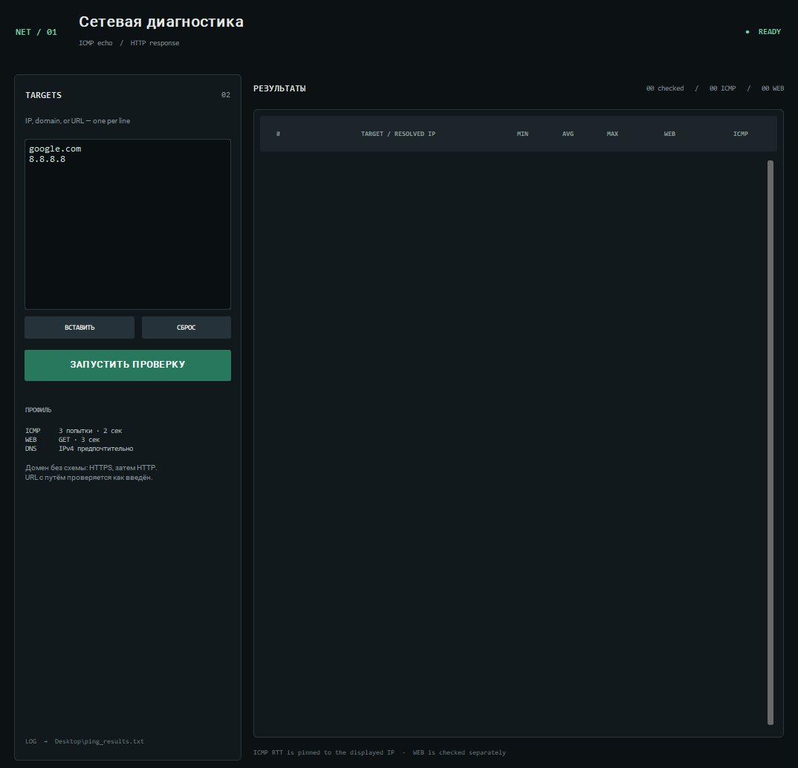

# PingDesk - Mass IP Pinger

A simple and convenient GUI application written in Python for mass pinging IP addresses and domains. This tool is designed to help network administrators and users quickly check the availability and latency of multiple hosts simultaneously.

## Features
* **Mass Ping:** Paste a list of IPs or domains (one per line) and ping them all at once.
* **Latency Calculation:** Automatically calculates and displays the minimum, average, and maximum latency (in ms).
* **Auto-Save:** Automatically saves all results, including timestamps, to a `.txt` log file on your desktop.
* **User-Friendly Interface:** Built with a clean and easy-to-use graphical interface.

## Screenshot

*(Note: You can find more screenshots in the `docs` folder)*

## Tech Stack
* **Language:** Python 3
* **GUI Library:** CustomTkinter / Tkinter
* **Networking:** Ping3

## How to Run (Source Code)
If you want to run the application from the source code, follow these steps:

1. Clone the repository or download the source code.
2. Install the required dependencies:
   ```bash
   pip install -r requirements.txt
