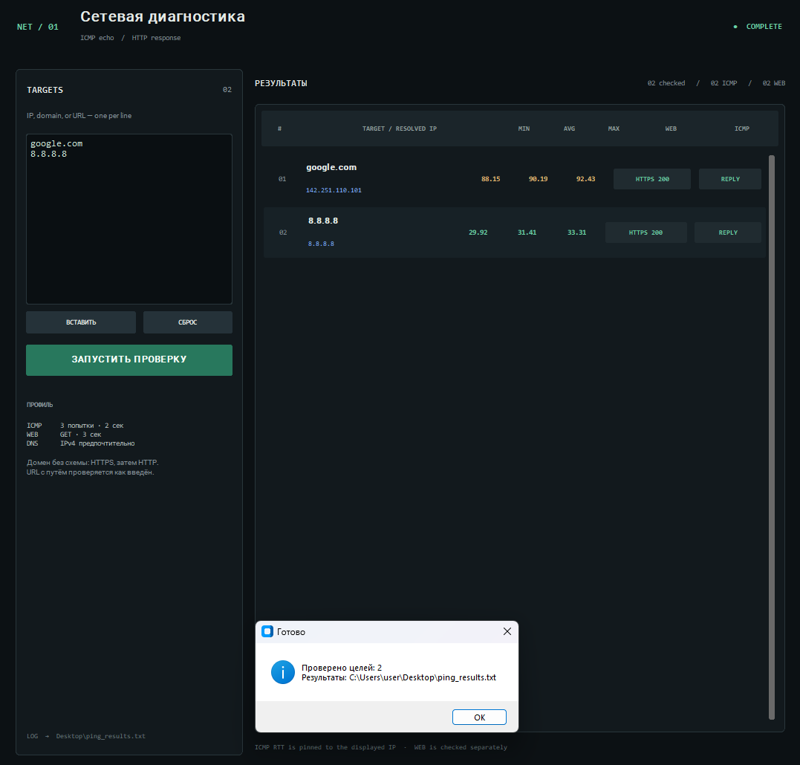

# PingDesk

**Windows desktop app for checking network reachability with ICMP and HTTP/HTTPS.**

[Русский](#русский) · [English](#english)

[Download the latest release](https://github.com/mvdsx/ping-tester/releases/latest)

---

## Русский

PingDesk — приложение для проверки IP-адресов, доменов и URL. Оно показывает результаты ICMP-проверки и отдельно проверяет ответ веб-сервера по HTTP/HTTPS.

### Возможности

- Проверка нескольких IP-адресов, доменов или URL — по одному на строку.
- Три ICMP-запроса к одному IP-адресу; отображение минимального, среднего и максимального времени ответа.
- Отображение IP-адреса, выбранного для проверки. Если доступен IPv4, он используется в первую очередь.
- Отдельный HTTP `GET`-запрос с отображением кода ответа, например `HTTPS 200` или `HTTP 404`.
- Для домена без указанного протокола сначала проверяется HTTPS, затем HTTP. Для полного URL используются указанные протокол и путь.
- Цвет задержки: зелёный — до 50 мс, оранжевый — до 150 мс, красный — выше 150 мс.
- Вставка адресов кнопкой, через контекстное меню или `Ctrl+V`, в том числе при русской раскладке.
- Сохранение результатов в `ping_results.txt` на рабочем столе.

### Скриншоты




### Как пользоваться

1. Скачайте `PingDesk.exe` со страницы [последнего релиза](https://github.com/mvdsx/ping-tester/releases/latest) или запустите приложение из исходников.
2. Введите или вставьте цели в поле `TARGETS`, по одной на строку. Например:

   ```text
   google.com
   8.8.8.8
   https://example.com/status
   ```

3. Нажмите **«ЗАПУСТИТЬ ПРОВЕРКУ»**. Результаты появятся в таблице.

### Как читать результаты

- `REPLY` — получен ответ на ICMP-запрос.
- `NO REPLY` — ICMP-ответ не получен. Некоторые серверы блокируют ping, поэтому сайт может открываться в браузере, но не отвечать на ICMP.
- `NO DNS` — домен не удалось преобразовать в IP-адрес.
- `HTTPS 200`, `HTTP 404` и подобные значения — ответ веб-сервера. Даже код `4xx` или `5xx` означает, что сервер ответил.

ICMP-проверка выполняется три раза с таймаутом до 2 секунд на запрос. HTTP-запрос ожидает ответ до 3 секунд.

### Запуск из исходников

Для запуска нужны Windows и Python:

```powershell
python -m pip install -r requirements.txt
python main.py
```

### Сборка приложения

```powershell
python -m pip install pyinstaller
python -m PyInstaller --noconfirm --clean --onefile --windowed --name PingDesk --collect-all customtkinter --distpath "$env:USERPROFILE\Desktop" main.py
```

Готовый `PingDesk.exe` появится на рабочем столе.

---

## English

PingDesk is a desktop app for checking IP addresses, domains, and URLs. It reports ICMP results and separately checks web server responses over HTTP/HTTPS.

### Features

- Check multiple IP addresses, domains, or URLs — one target per line.
- Send three ICMP requests to the same IP address and show minimum, average, and maximum latency.
- Display the IP address used for the check. IPv4 is preferred when available.
- Make a separate HTTP `GET` request and show the response code, such as `HTTPS 200` or `HTTP 404`.
- For a domain without a specified protocol, try HTTPS first and then HTTP. Full URLs are checked using their specified protocol and path.
- Latency colors: green — up to 50 ms, orange — up to 150 ms, red — above 150 ms.
- Paste targets using the button, context menu, or `Ctrl+V`, including with the Russian keyboard layout active.
- Save results to `ping_results.txt` on the desktop.

### Screenshots


### Usage

1. Download `PingDesk.exe` from the [latest release](https://github.com/mvdsx/ping-tester/releases/latest), or run the application from source.
2. Enter or paste targets in the `TARGETS` box, one per line. For example:

   ```text
   google.com
   8.8.8.8
   https://example.com/status
   ```

3. Click **“ЗАПУСТИТЬ ПРОВЕРКУ”**. The results will appear in the table.

### Reading the results

- `REPLY` — an ICMP response was received.
- `NO REPLY` — no ICMP response was received. Some servers block ping, so a website may load in a browser but not respond to ICMP.
- `NO DNS` — the domain could not be resolved to an IP address.
- Values such as `HTTPS 200` and `HTTP 404` show the web server's response. A `4xx` or `5xx` status still means the server responded.

ICMP is sent three times, with a timeout of up to 2 seconds per request. The HTTP request waits up to 3 seconds.

### Run from source

Windows and Python are required:

```powershell
python -m pip install -r requirements.txt
python main.py
```

### Build the application

```powershell
python -m pip install pyinstaller
python -m PyInstaller --noconfirm --clean --onefile --windowed --name PingDesk --collect-all customtkinter --distpath "$env:USERPROFILE\Desktop" main.py
```

The resulting `PingDesk.exe` will be placed on the desktop.
